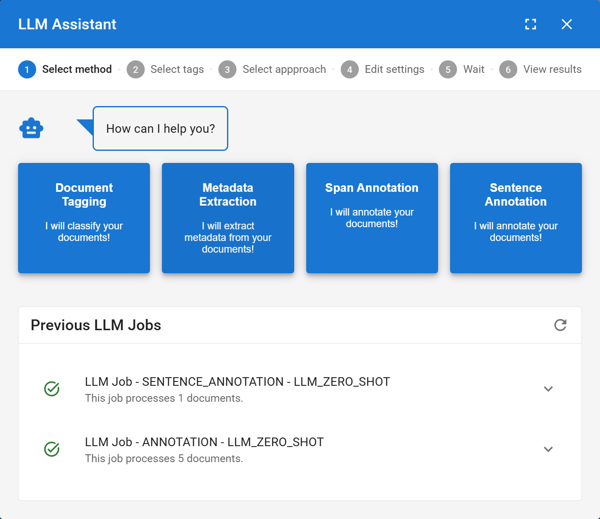
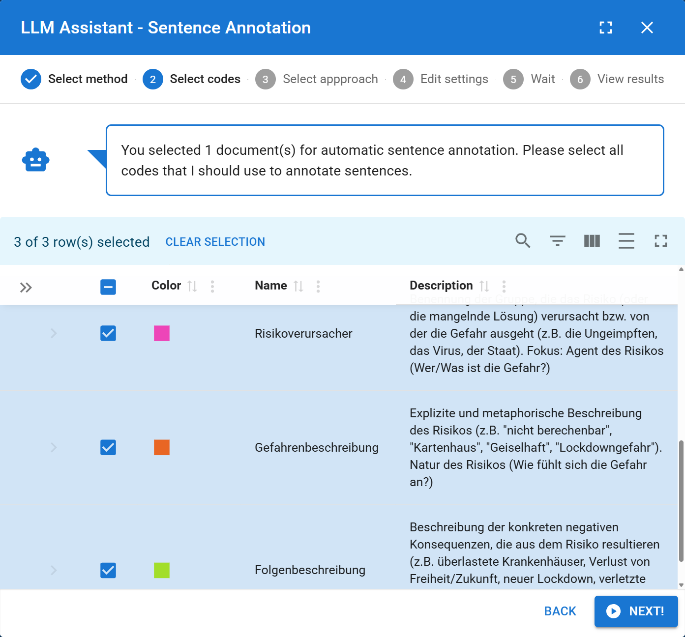
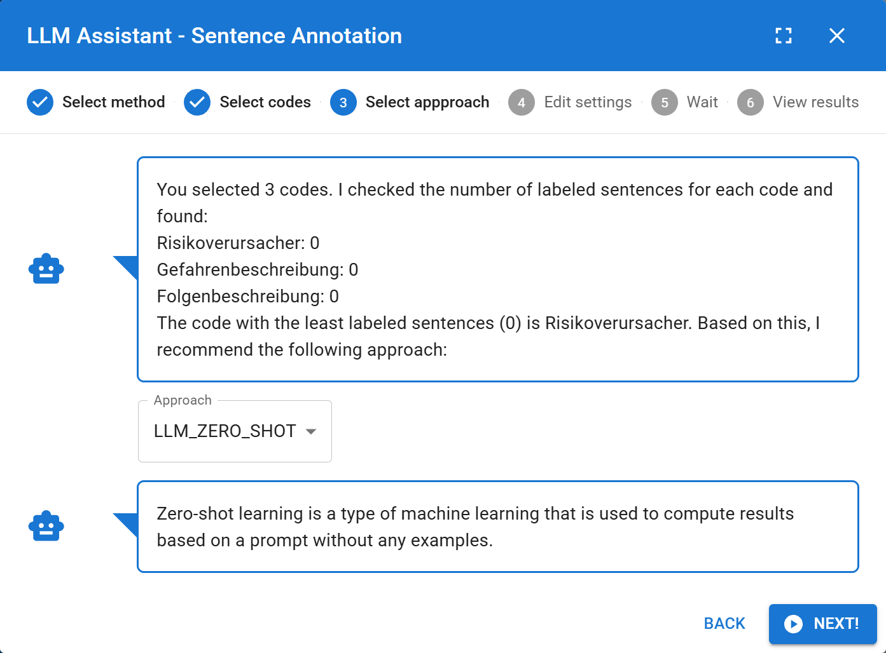
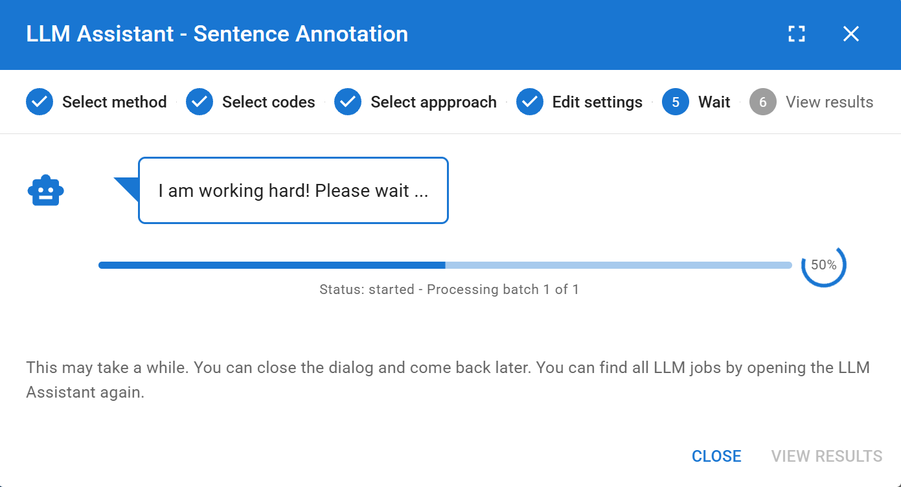
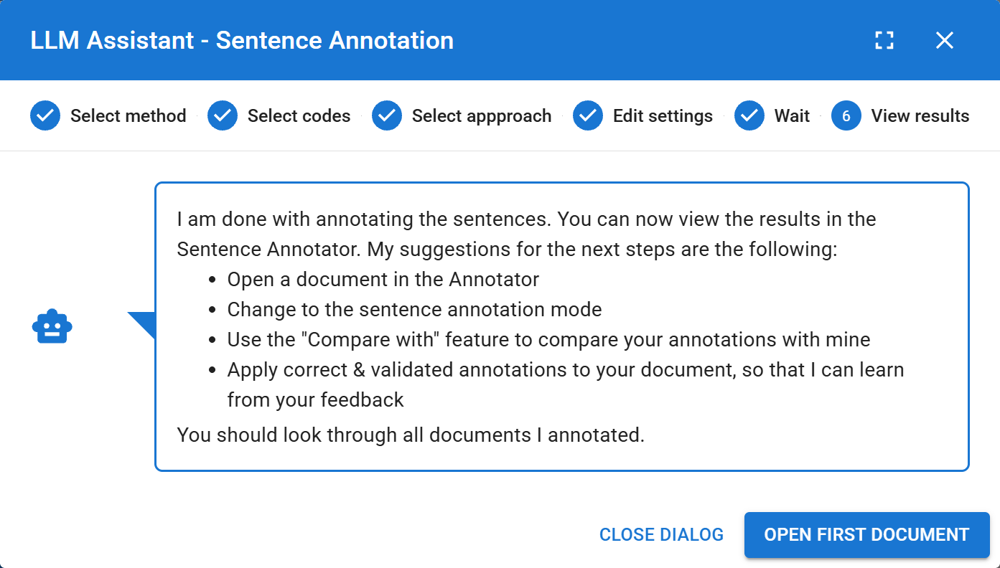
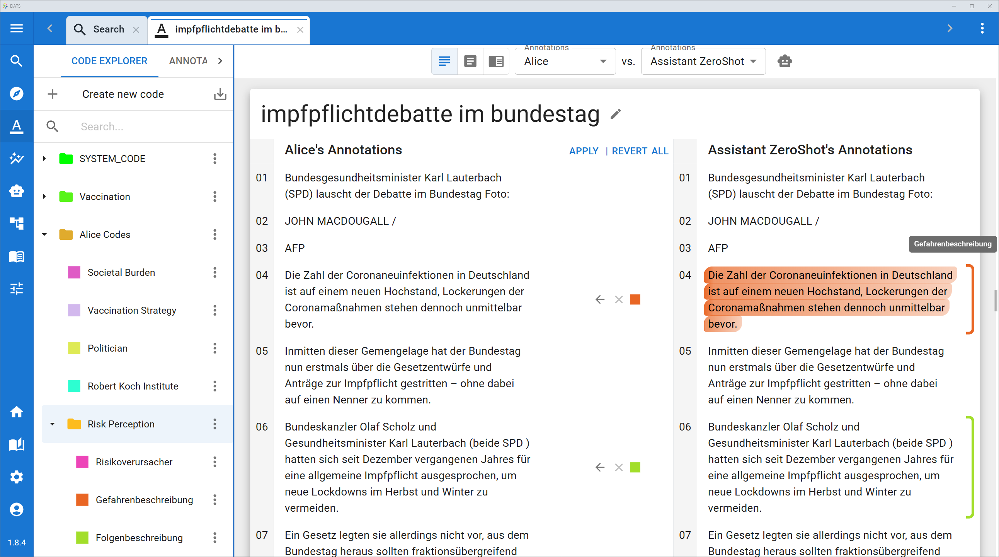

# The LLM Assistant

While manual coding is the foundation of qualitative discourse analysis, it can become incredibly time-consuming when dealing with massive datasets. To accelerate your research workflow, DATS features an integrated **LLM Assistant** that leverages state-of-the-art Large Language Models (LLMs) to automatically suggest tags, extract metadata, and generate text annotations.

Because the assistant operates strictly within DATS using secure, locally hosted models (like Gemma or Llama), your sensitive research data remains entirely private.

_(For a deeper dive into the methodology and evaluation of this AI-assisted workflow, please refer to our publications: [Exploring Large Language Models for Qualitative Data Analysis](https://aclanthology.org/2024.nlp4dh-1.41/) and [Semi-automatic Sequential Sentence Classification in the Discourse Analysis Tool Suite](https://aclanthology.org/2025.naacl-demo.16/))._

## 1\. Accessing the Assistant

Before the AI can help you, it needs to know _which_ documents to analyze. Therefore, you can access the LLM Assistant in two different ways depending on your current workflow:

### Method A: Single Document (From Annotation View)

When you are deep-reading a specific file in the **Annotation View**, you can ask the assistant to help you code that exact file.

1. Look at the top Annotation Toolbar (where you select your reading mode).
2. Click the **Robot icon**.
3. This opens the LLM Assistant Dialog to process _only_ the currently open document.

### Method B: Batch Processing (From Search View)

If you want the AI to analyze dozens or hundreds of documents at once, you must initiate the job from the **Search View**.

1. Use the search bar and filters to find the documents you want to analyze.
2. Select the documents using the checkboxes in the results table. _(Tip: Use the master checkbox at the top to select all visible rows)._
3. Once at least one document is selected, the **Robot icon** will appear in the top toolbar. Click it to open the dialog for your selected batch.

## 2\. The Multi-Step Workflow

The dialog guides you through a simple, step-by-step configuration process. _(The following example assumes you chose Span Annotation)._

## 1\. Choosing a Task

_Select the specific qualitative task you want the AI to automate._

When the dialog opens, the assistant will greet you and ask what kind of help you need. You can choose from four distinct AI tasks, which guide you through the following steps:

- **Document Tagging:** The AI will read the documents and suggest which structural Tags (e.g., Domain: Politics, Sentiment: Negative) should be applied to them as a whole.
- **Metadata Extraction:** The AI will scan the text to automatically populate custom metadata fields (e.g., finding the Author or Publication Date hidden in the text).
- **Span Annotation:** The AI will highlight specific words or phrases and assign them to your qualitative Codes.
- **Sentence Annotation:** The AI will classify entire, discrete sentences according to your Codebook.

Or choose **Prompt** to run one of your [prompts](prompts.md). A prompt decides everything except the documents and the model: the task, the codes, tags or metadata fields, the few-shot examples and the input and output format. You select the prompt and its version, then the model, review the prompt and start. Write prompts, versions and examples on the **Prompts** page.

### Step 2: Select Targets (Codes, Tags, or Metadata)

You must tell the AI _what_ to look for.

- A list of your project's Codes (or Tags/Metadata) will appear.
- Use the checkboxes to select the specific categories you want the AI to apply.
- _Note:_ The AI relies heavily on the **Descriptions** you wrote for these codes in the Project Settings. The better your written description, the more accurate the AI's predictions will be!

### Step 3: Edit Settings

Choose the language model and how the assistant works:

- **Language** of the prompt (English or German). The documents can be in any language.
- **Input format**: send each document as a whole, sentence by sentence, or in overlapping chunks. Tagging and metadata extraction always send the whole document. Chunks have **input parameters**: chunk size and overlap.
- **Output format**, i.e. how the model answers and how DATS maps the answers back to your documents. For span annotation: inline tags (the model repeats the text with tagged passages) or quotes with context (the model returns quotes that DATS locates in the text). **About ...** explains the selected format with an example. Quotes with context have **output parameters**: the context length and the fuzzy matching threshold.

### Step 4: Review the Prompt

The **preview** shows exactly what the AI receives: the built-in default prompt of the task, output format and language with your selections. Built-in prompts cannot be edited; every project has a copy of each on the Prompts page (e.g. `default-span-annotation-inline-tagging-en`), which you can edit and run with **Prompt**. Pick one of the selected documents; a prompt sent sentence by sentence can step through its sentences. If more than 100 documents are selected, the preview's document selector lists only the first 100; the job still processes every selected document. Guided runs are zero-shot; for few-shot examples and your own prompt texts, write a [prompt](prompts.md) and run it with **Prompt**.

For span and sentence annotation you also choose whom the assistant **annotates as**: an existing [virtual user](project-view.md#virtual-users-tab) of the project, or a new one you name here (proposed: the next free `LLM-Run<n>`). The assistant never writes into your own annotations. Use a new virtual user per run to compare runs, models or prompts with each other and with your team in the compare view and the agreement evaluation.

If the selected virtual user already annotated the selected documents with the selected codes, you choose here whether these annotations are replaced or kept.

### Step 5: Wait (Background Processing)

Click **Start!** The dialog will close, and the job will run asynchronously in the background. You are free to continue reading or analyzing other documents while the AI works.

- To check the progress, simply click the Robot icon again to open the dialog and look at the **Previous LLM Assistant Jobs** list at the bottom of the welcome screen.
- **Abort the job** stops a started job. **Retry the job** requeues a failed or stopped job.
- The assistant saves results batch by batch, so a stop or failure does not roll back results saved by earlier batches. A retry continues from the last checkpoint and skips documents whose results were already saved as finished or partial; documents with error results are processed again.
- A deleted document or one whose processing fails receives an error result; the other documents of its batch are still saved. If the LLM is unavailable for every request in a batch, the job fails before saving that batch and can be retried.
- Once the job is finished, open it to see the results.

## 6\. Reviewing and Applying Results

Because qualitative research requires human oversight, annotation jobs write their suggestions into the **virtual user** you selected, never into your own annotations.

1. Once a job is finished, open the LLM Assistant dialog and open its results from the **Previous LLM Assistant Jobs** list.
2. The summary shows how many documents were annotated and how many annotations were created. Expand a document to see its status and annotation counts per code. Error and partial results also include error details and, when available, the raw responses of failed requests; long raw responses are truncated.
3. Click **Open first document** to review the suggestions in the Annotation View. Use **Compare with** to select the virtual user and compare its suggestions with your own annotations.
4. Apply the suggestions you validate to your own annotations in the comparison view.

_(Note: AI-generated annotations belong to the virtual user you chose, so they are always distinguishable from your own manual coding in the analysis views!)_
